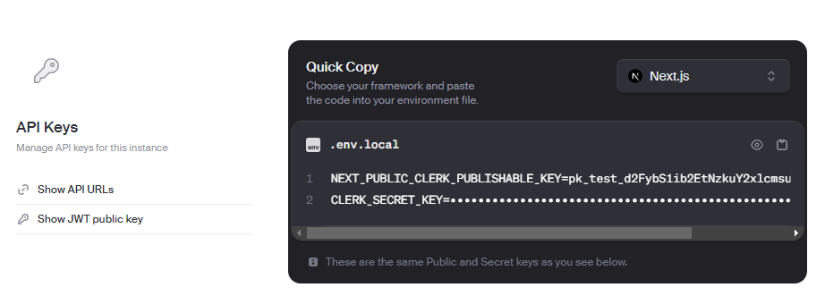

### Inialize your Environment Variables
- copy `.env.example` to `.env.local`

```sh
cp .env.example .env.local
```


### Clerk

- Create an Account at [Clerk](https://dashboard.clerk.com/sign-up)
- Create a [New App](https://dashboard.clerk.com/apps/new)
- Access API Keys and Copy `.env.local` data



### ngrok
- Create an Account at [ngrok](https://dashboard.ngrok.com/signup)
- Create a [New AuthTokens](https://dashboard.ngrok.com/authtokens/new)
- Copy your token to `.env.local` and paste at `NGROK_AUTHTOKEN`


### Configure Docker

```
// Build App and Worker Image
make build


// Install App and Worker dependency locally
make npm-install

//Run all containers `App`, `Worker`, `Queue`, `Database` and `ngrok`
make up
```

### Configuring Clerk Webhook
- Access your Local [ngrok Endpoints](http://localhost:4040/inspect/http)
- Access Clerk Webhooks and Create a New Webhook
- Copy the URL to your Clerk Webhook 
    - `{Ngrok URL}`/webhooks/on-create-account
- Subscribe user -> user.created
- Copy Clerk Webhook Signing Secret to `CLERK_WH_SECRET_KEY` to your `.env.local`
- Restart your App container
    - `docker compose restart app`


### Setup Database
```sh
make db-migrate
```

